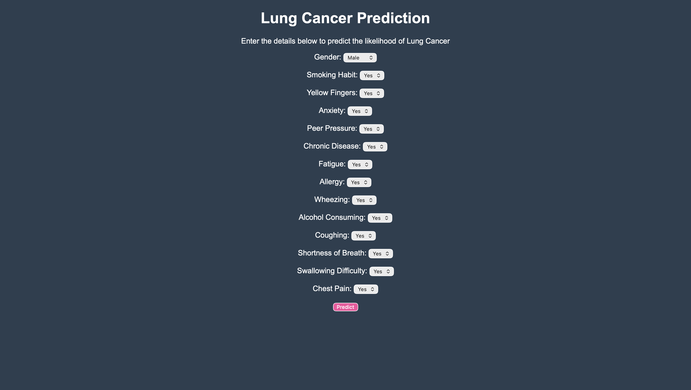
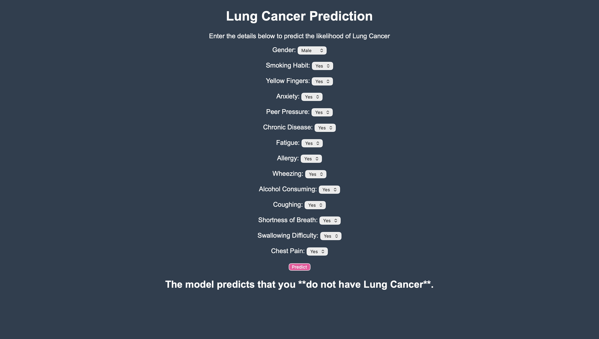
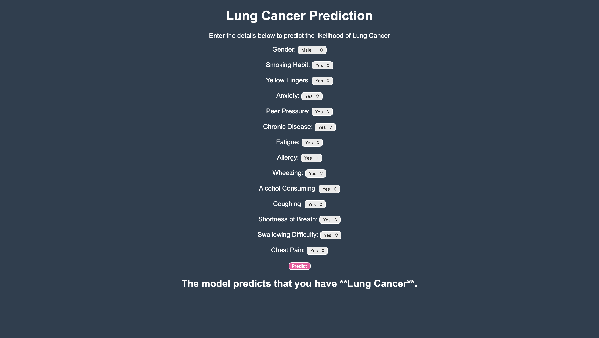

# Lung Cancer Risk Prediction

A machine-learning project that estimates lung cancer risk from survey responses. The project includes an exploratory/training notebook and a Flask web interface backed by a tuned support vector machine (SVM).

> This project is for educational purposes only. It is not a medical device and must not be used for diagnosis or treatment decisions.

## What it does

- Explores and preprocesses structured survey data.
- Removes `GENDER`, `AGE`, `SMOKING`, and `SHORTNESS OF BREATH` before training.
- Standardises the remaining 11 features.
- Uses SMOTE and grid search to train and tune an SVM classifier.
- Serves predictions through a Flask form.

## Repository structure

```text
.
├── LungCancer.ipynb        # Data exploration, training, and evaluation
├── app_CSV.py              # Flask prediction application
├── templates/
│   └── index.html          # Web form
├── screenshots/            # Application screenshots
├── requirements.txt
└── README.md
```

The training dataset and generated model files were not present in the source archive. To reproduce the project, add the dataset as `survey_lung_cancer.csv`, run the notebook, and generate:

- `lung_cancer_model.pkl`
- `scaler.pkl`

## Setup

Python 3.10 or 3.11 is recommended.

```bash
python -m venv .venv
source .venv/bin/activate        # Windows: .venv\Scripts\activate
python -m pip install --upgrade pip
pip install -r requirements.txt
```

## Train the model

1. Place `survey_lung_cancer.csv` in the repository root.
2. Start Jupyter with `jupyter notebook`.
3. Open and run `LungCancer.ipynb` from top to bottom.
4. Confirm that the notebook creates the model and scaler files listed above.

The notebook expects a survey dataset with the same columns used by the original project.

## Run the Flask app

After generating the model files:

```bash
python app_CSV.py
```

Open `http://127.0.0.1:5000` in a browser.

## Screenshots

### Home page



### Negative prediction example



### Positive prediction example



## Author

Rewa Dambal — [GitHub](https://github.com/rewa-d)
